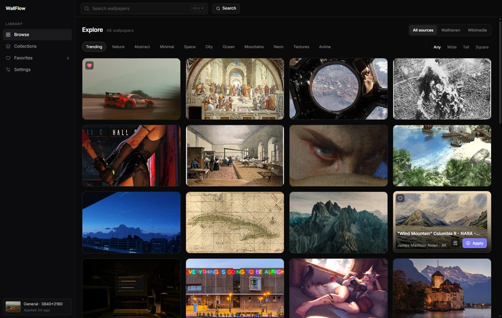

# WallFlow

A small, fast Windows wallpaper browser — search a million-plus wallpapers, preview them full screen, and set them on your desktop in one click.

Built with **Rust** (Tauri 2) for the desktop backend and **React + Tailwind** for the interface. No Electron, no bundled browser: the window is the system WebView2 and all fetching, storage and wallpaper work happens in Rust.



## Features

- **Browse & search** — responsive grid, keyword search, categories and orientation filters
- **Merged sources** — Wallhaven, Wikimedia, Konachan, Safebooru, DeviantArt, Bing's daily picks and your own feeds are searched together and streamed into one feed as each answers
- **Preview** — full-screen preview with resolution/author metadata before you commit
- **Apply** — downloads the full-resolution image and sets it as the real Windows wallpaper
- **Local wallpapers** — import single images or a whole folder (subfolders included) and apply them straight from disk
- **Favorites & collections** — saved locally in `%APPDATA%/WallFlow/wallflow-data.json`
- **Auto-rotate** — cycle a collection or your favorites every 5–240 minutes
- **Themes** — six dark palettes (Midnight, Slate, Graphite, Plum, Moss, Ember); the window frame is painted black to match
- **Custom sources** — add RSS feeds or a direct image/video URL

## Where the wallpapers come from

Everything is browsable **without accounts or API keys**:

| Source | Catalog | Notes |
| --- | --- | --- |
| [Wallhaven](https://wallhaven.cc) | 1M+ | Curated desktop wallpapers, SFW only (`purity=100`), on by default |
| [Wikimedia Commons](https://commons.wikimedia.org) | 100M+ | Freely licensed photography and art, on by default |
| [Konachan](https://konachan.net) | 1M+ | Anime, game art and illustrations, SFW only (`rating:safe`), on by default |
| [Safebooru](https://safebooru.org) | 5M+ | Anime & game fan art, SFW-only board, on by default |
| [DeviantArt](https://www.deviantart.com) | 500M+ | Fan art & digital art, adult submissions dropped (previews cap near 1200px), on by default |
| [Bing daily](https://www.bing.com) | 8 | One curated 4K landscape a day, last eight kept, on by default |
| [Openverse](https://openverse.org) | 900M+ | CC-licensed photos from Flickr, museums and more (see limits below) |
| Your feeds | — | RSS feeds and direct image/video links |

Every enabled catalog is queried together and the results are interleaved, so there is no per-source
filter in the browser — switch catalogs off entirely in **Settings → Sources** if you want a narrower
feed. Konachan, Safebooru, DeviantArt and Bing are on by default, and existing installs pick them up
automatically on first launch. Openverse is off by default because [its anonymous
tier](https://api.openverse.org/v1/) allows only 20 results per page and roughly 200 requests a day.

Pexels and Pixabay require a personal API key for every user, and Unsplash's keyless `napi` endpoint
is bot-gated (401), so the app ships with keyless catalogs only. Adding a keyed source is one function
in `src-tauri/src/sources.rs` plus one entry in that file's match and one label in
`src/types/wallpaper.ts`.

## Requirements

- Windows 10/11 (x64) with the WebView2 runtime (preinstalled on Windows 11)
- Node.js 20+ for the React interface
- Rust (stable) with the MSVC toolchain and Windows SDK for the desktop backend

## Commands

```bash
npm install          # interface dependencies
npm run dev          # Tauri dev window with the Vite dev server
npm run build        # releases the app and bundles the NSIS installer
npm run build:renderer  # only rebuild the React bundle into dist/
npm run typecheck    # React/TypeScript checks
npm run icon         # regenerate build/icon.png and build/icon.ico
```

`npm run build` (which runs `tauri build`) writes the installer to
`src-tauri/target/release/bundle/nsis/`. It is a per-user install with a desktop shortcut.

On this machine the Tauri CLI needs the MSVC environment, so `run-tauri.bat build` is the shortcut
that loads `vcvars64.bat` first.

## Project structure

```
src/                  React interface
  components/         layout (sidebar, top bar), wallpaper card/grid/preview, dialogs, ui kit
  pages/              browse, collections, favorites, local, settings
  store/              zustand stores (browse, library, settings, ui, toasts)
  types/              wallpaper + bridge contracts
  utils/              cn, formatters, apply hook, theme palettes
  tauri-bridge.ts     window.wallflow API backed by Tauri commands
src-tauri/            Rust backend
  src/main.rs         Tauri commands, window setup, rotation loop
  src/sources.rs      the six catalogs plus custom RSS/direct feeds
  src/apply.rs        Win32 wallpaper apply + downloads
  src/store.rs        data model and JSON persistence
  tauri.conf.json     window, bundle and permission configuration
  capabilities/       webview permissions (dialog, core)
```

## How it works

- **Fetching happens in Rust.** Each catalog runs on its own thread and results stream back to the
  interface over the `sources:partial` event, so the grid paints in well under a second while slower
  sources keep loading. Every command runs off the UI thread, so searching or applying never freezes
  the window.
- **Applying images** downloads the file, then calls
  `User32!SystemParametersInfo(SPI_SETDESKWALLPAPER)` directly, with `WallpaperStyle=10` so the
  picture always fills the desktop.
- **Storage** is a single JSON file at `%APPDATA%/WallFlow/wallflow-data.json`, written as you change
  things. Downloaded images go to the app cache folder, reachable from **Settings → About**.
- **Local files** are read from wherever you keep them and shown through Tauri's asset protocol, so
  nothing is copied.

## Notes

- Every catalog is filtered to safe content: Wallhaven uses `purity=100`, Konachan uses
  `rating:safe`, Safebooru is an SFW-only board, DeviantArt's adult-rated deviations are dropped, and
  Openverse sends `mature=false`. Wikimedia queries are restricted to bitmap files at least 1600 px
  wide.
- Images are only shown when they are big enough to be a wallpaper: Wallhaven asks for 1920×1080+,
  the boorus drop anything under 1600 px wide, and Bing serves its 4K UHD file.
- `Ctrl K` focuses the search box, `Esc` closes the preview.
- **Not ported yet:** video wallpapers (MP4/WebM loops over the desktop) and switching the monitor
  resolution from Settings. Both report a clear message instead of failing silently.

## License

MIT
