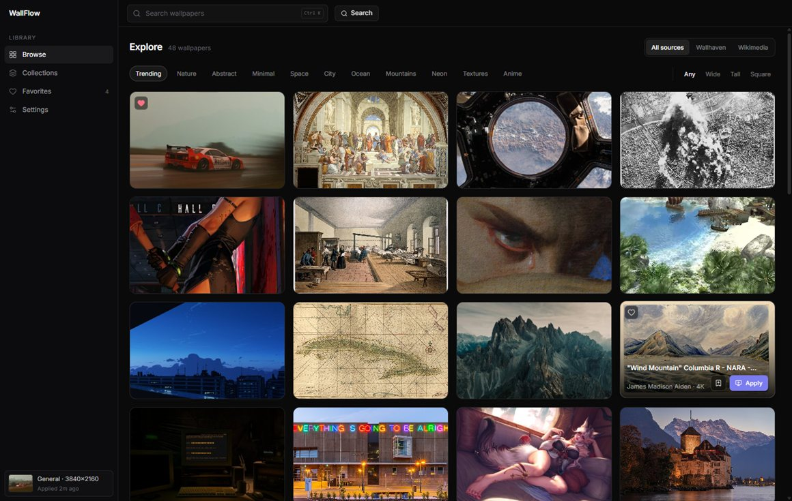

# WallFlow

A small, fast Windows wallpaper browser — search a million-plus wallpapers, preview them full screen, and set them on your desktop in one click.

Built with Electron + React + Tailwind, packaged with electron-builder.



## Features

- **Browse & search** — responsive grid, keyword search, categories and orientation filters
- **Source switcher** — browse everything at once or a single catalog: Wallhaven, Wikimedia, your own feeds
- **Preview** — full-screen preview with resolution/author metadata before you commit
- **Apply** — downloads the full-resolution image and sets it as the real Windows wallpaper
- **Video wallpapers** — MP4/WebM loops play in a borderless, click-through window over the desktop
- **Favorites & collections** — saved locally in SQLite
- **Auto-rotate** — cycle a collection or your favorites every 5–240 minutes
- **Display resolution** — list the modes your monitor reports and switch resolution from the app
- **Custom sources** — add RSS feeds or a direct image/video URL

## Where the wallpapers come from

Everything is browsable **without accounts or API keys**:

| Source | Catalog | Notes |
| --- | --- | --- |
| [Wallhaven](https://wallhaven.cc) | 1M+ | Curated desktop wallpapers, SFW only (`purity=100`) |
| [Wikimedia Commons](https://commons.wikimedia.org) | 100M+ | Freely licensed photography and art |
| Your feeds | — | RSS feeds and direct image/video links |

The original brief also listed Unsplash, Pexels and Pixabay. Pexels and Pixabay require a personal
API key for every user, and Unsplash's keyless `napi` endpoint is now bot-gated (401), so v1 ships
with the two keyless catalogs above instead. Adding a keyed source is one file in `src/services/`
plus one entry in `src/types/wallpaper.ts`.

## Requirements

- Windows 10/11 (x64)
- Node.js 20+ (developed on Node 24)

## Commands

```bash
npm install       # install dependencies
npm run dev       # Vite + Electron with hot reload
npm run build     # build the renderer + main process, then package dist/WallFlow-<version>-setup.exe
npm run typecheck # renderer and main-process TypeScript checks
npm run icon      # regenerate build/icon.png and build/icon.ico
```

`npm run build` writes the NSIS installer to `dist/`. It is a per-user install with a desktop
shortcut. The clean, ready-to-ship copy of the installer lives in `installer/` (only the `.exe`,
nothing else).

## Project structure

```
src/
  components/
    layout/        sidebar, top bar
    wallpaper/     card, grid, preview dialog, save dialog
    collections/   collection card
    settings/      add-source dialog
    ui/            button, input, dialog, select, switch, slider, toast, …
  pages/           browse, collections, favorites, settings
  services/        source clients (wallhaven, commons, custom) — main process only
  store/           zustand stores (browse, library, settings, ui, toasts)
  types/           wallpaper + IPC contracts
  utils/           cn, formatters, apply hook
electron/
  main.ts          app lifecycle and window
  preload.ts       context-isolated `window.wallflow` bridge
  ipc.ts           IPC handlers
  store/           SQLite store with JSON fallback
  wallpaper/       Win32 apply, video window, player page, shared service
  display/         display-mode enumeration and ChangeDisplaySettings
  utils/           media cache downloads
  rotation.ts      auto-rotate scheduler
scripts/           dev runner, esbuild build, icon generator
```

## How it works

- **Fetching happens in the main process.** The renderer never touches remote APIs, so there are no
  CORS problems and the renderer's CSP can stay strict (`script-src 'self'`).
- **Applying images** uses `User32!SystemParametersInfo(SPI_SETDESKWALLPAPER)` through PowerShell and
  sets the wallpaper style to "Fill". That is the same Win32 mechanism the `wallpaper` npm package
  uses, but without a native addon to rebuild or bundle.
- **Applying videos** downloads the loop into the app cache and plays it in a frameless
  `BrowserWindow` pinned to the work area with `setIgnoreMouseEvents(true)` and
  `setAlwaysOnTop(false)`. A still frame is set as the actual desktop wallpaper first.
  *Limitation:* the window sits above the desktop icons and below normal windows. Truly rendering
  behind the icons requires parenting to Explorer's `WorkerW` window in native code.
- **Storage** lives in `%APPDATA%/WallFlow`: `wallflow.db` (better-sqlite3, N-API prebuild) with an
  automatic JSON fallback at `wallflow-data.json` if the native module can't load. Downloaded media
  goes to `wallpaper-cache/`.

## Notes

- Wallhaven is filtered to SFW content and requires no key; Wikimedia queries are restricted to
  bitmap files at least 1600 px wide.
- The app is single-instance and remembers the last applied wallpaper ("Applied 2m ago" in the
  sidebar).
- `Ctrl K` focuses the search box, `Esc` closes the preview.
